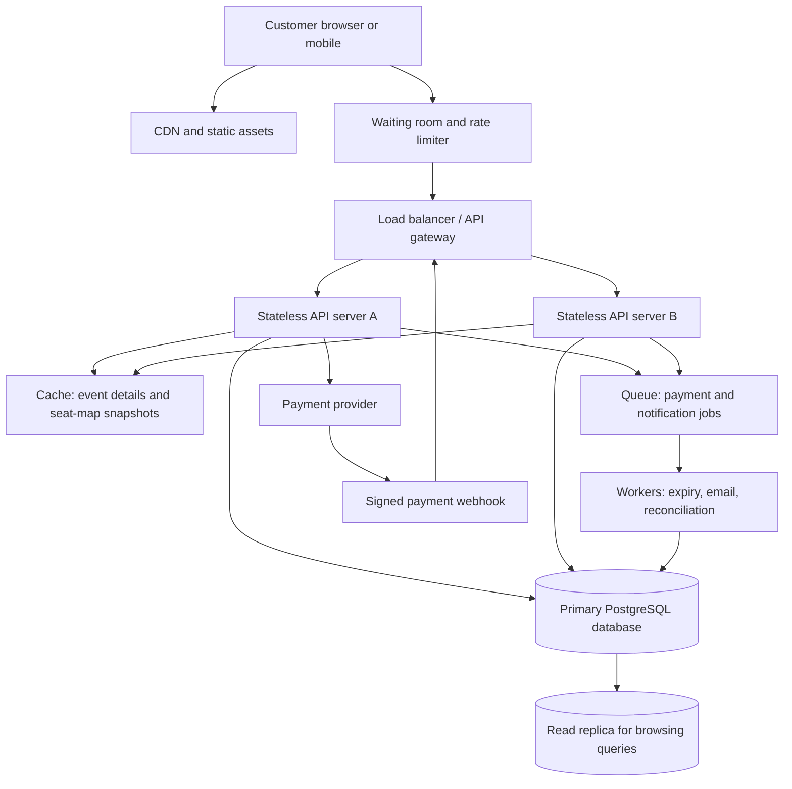

# TicketHub: Event Ticketing System Design

## 1. Context, goals, and requirements

### Context
TicketHub is a website where people discover concerts and events, view seat availability, reserve seats temporarily, pay, and access their tickets. The system must support ordinary daily browsing as well as a very popular concert sale where demand greatly exceeds the number of seats.

### Goals
- Let registered users browse events, view seat maps, reserve available seats, pay, and retrieve confirmed tickets.
- Keep seat availability and orders correct even when many customers act at the same time.
- Keep browsing responsive during a sale and prevent one customer from purchasing a seat already sold to another customer.
- Treat payment callbacks and client retries safely, without creating duplicate orders or charges.

### Non-goals for this first version
- Resale between customers.
- Dynamic pricing or auctions.
- Multiple currencies and complex tax rules.
- A globally distributed, multi-region write database. Start with one authoritative transactional database and scale reads separately.

### Functional requirements
1. Users can register/sign in and view events, dates, venues, prices, and availability.
2. Users can view a seat map and the current status/price of each seat.
3. Users can temporarily hold one or more available seats for a limited time.
4. Users can pay for a valid hold and receive a confirmed order/ticket.
5. Users can view their orders and tickets.
6. Users can cancel an unpaid hold; expired holds become available again.
7. The system records payment success/failure and supports safe retries.
8. Administrators can create events, configure seat maps, prices, and sale opening times.

### Non-functional requirements
- **Speed:** event listings should normally load within 2 seconds at the 95th percentile; seat availability and hold responses should normally complete within 1 second at the 95th percentile, excluding external payment-provider delays.
- **Correctness:** a seat must never have two active holds or two confirmed sales for the same event. The database—not only application code—must enforce this.
- **Fairness:** use a waiting room/queue during oversubscribed sales, rate-limit abusive clients, and issue access tokens in queue order. Do not promise that every person will get a seat; demand can exceed supply by design.
- **Availability:** browsing should remain available during a sale even if checkout is throttled. A failed payment service should not cause a seat to be marked sold.
- **Durability:** confirmed orders and payment records must survive application-server restarts.
- **Security/privacy:** authenticate users, authorize access to their own orders, validate inputs, protect payment callbacks, and avoid storing raw card details.
- **Scalability:** support 2 million registered users and scale stateless application servers horizontally.
- **Observability:** monitor request latency, error rates, queue length, hold expiries, payment failures, and database lock waits.

## 2. Traffic and storage estimates

These are planning estimates, not measured production figures. A day has 86,400 seconds.

### Normal day
- Registered users: 2,000,000.
- Visitors: 50,000 per day.
- Page views: 50,000 visitors × 10 pages = **500,000 page views/day**.
- Average page-view rate: 500,000 ÷ 86,400 ≈ **5.8 page views/second**.
- Assume normal traffic peaks at 5 times the daily average: about **29 page views/second**, rounded to 30.
- Tickets sold: 5,000/day. Average sales rate: 5,000 ÷ 86,400 ≈ **0.058 tickets/second**, or about 1 ticket every 17 seconds.
- If each page view causes 3 API calls on average, normal average API traffic is roughly 17 requests/second, with an assumed peak near 90 requests/second.

### Popular-concert sale
- 200,000 people try to buy tickets within 10 minutes (600 seconds).
- Average arrival rate: 200,000 ÷ 600 ≈ **333 people/second**.
- There are 20,000 seats, so even if every seat sells, only 20,000 of the 200,000 people can get a seat: **10% of people can succeed at most**.
- To plan for bursts, assume a 3× peak over the average: about **1,000 purchase attempts/second**. A customer may generate several API requests, so the waiting room and rate limits should protect checkout and the database.
- The demand-to-seat ratio is **10:1**, far higher than normal traffic. The main risk is not just raw request volume: it is many customers competing to hold the same limited seats at once.

### Comparison and design implication
Normal browsing is modest and mostly read traffic. The concert sale creates a sudden burst and intense contention for a small inventory. Cache event descriptions and venue maps, use a waiting room to meter traffic into checkout, and keep seat holds and confirmed sales in an authoritative transactional database. Never rely on a cache as the final authority for whether a seat can be sold.

## 3. API design

All endpoints use HTTPS and JSON except the payment-provider callback. Authenticated endpoints require a session or bearer token. Use an `Idempotency-Key` on hold/checkout/payment-creation requests so retrying a request does not create duplicate orders or charges.

| Method and endpoint | Purpose | Success response |
|---|---|---|
| `GET /api/events?from=&to=&page=` | Browse/search events; cacheable | `200 OK` with event list and pagination |
| `GET /api/events/{eventId}` | Event details, venue, sale times | `200 OK` |
| `GET /api/events/{eventId}/seats` | Seat map and availability snapshot | `200 OK`; status can change immediately afterward |
| `POST /api/events/{eventId}/holds` | Hold selected seat IDs for a short period | `201 Created` with hold ID and expiry; `409 Conflict` if any seat is unavailable |
| `DELETE /api/holds/{holdId}` | Release an unpaid hold | `204 No Content` |
| `POST /api/holds/{holdId}/checkout` | Create an order/payment attempt for a valid hold | `201 Created` with order ID and payment status |
| `POST /api/payments/webhook` | Receive signed payment-provider status updates | `200 OK` after safe processing |
| `GET /api/me/orders` | List the signed-in user's orders | `200 OK` |
| `GET /api/me/orders/{orderId}/tickets` | Retrieve tickets for an order owned by the user | `200 OK` |
| `GET /api/queue/status` | Check waiting-room position/access status | `200 OK` |

### Example: hold seats
Request:
```http
POST /api/events/evt-42/holds
Authorization: Bearer <token>
Idempotency-Key: 8f4b...
Content-Type: application/json

{
  "seatIds": ["A-10", "A-11"]
}
```

Success (`201 Created`):
```json
{
  "holdId": "hold-7821",
  "eventId": "evt-42",
  "seatIds": ["A-10", "A-11"],
  "expiresAt": "2026-10-29T10:15:00Z",
  "status": "HELD"
}
```

If either seat is no longer available, return `409 Conflict` and do not partially hold the requested set.

### Example: error response
```json
{
  "error": {
    "code": "SEAT_UNAVAILABLE",
    "message": "One or more selected seats are no longer available."
  }
}
```

Common status codes: `400` invalid input, `401` unauthenticated, `403` unauthorized, `404` event/hold/order not found, `409` seat conflict or expired hold, `429` rate limit/waiting-room limit, `500` unexpected server error, `503` temporary service overload.

## 4. Data model

Use a relational database such as PostgreSQL because seat inventory, holds, orders, and payment state require transactions and integrity constraints.

### Tables and relationships

- **users**: one user can place many orders and create many holds.
- **events**: one event has many seats and orders.
- **seats**: each seat belongs to one event. `(event_id, seat_label)` is unique so a venue seat is not duplicated for the same event.
- **seat_holds**: a temporary claim on a seat by a user, with an expiry time and status. Holds are short-lived and are not proof of a sale.
- **orders**: one user can have many orders; each order belongs to one event. An order moves through states such as `PENDING_PAYMENT`, `CONFIRMED`, `PAYMENT_FAILED`, or `EXPIRED`.
- **order_items**: connects orders to seats. Each item represents one seat being purchased.
- **payments**: payment attempts and provider references associated with an order. Provider event/reference IDs must be unique to make webhook processing idempotent.

### Example PostgreSQL schema
```sql
CREATE TABLE users (
    id BIGSERIAL PRIMARY KEY,
    email TEXT NOT NULL UNIQUE,
    created_at TIMESTAMPTZ NOT NULL DEFAULT now()
);

CREATE TABLE events (
    id BIGSERIAL PRIMARY KEY,
    name TEXT NOT NULL,
    venue TEXT NOT NULL,
    starts_at TIMESTAMPTZ NOT NULL,
    sale_opens_at TIMESTAMPTZ NOT NULL,
    status TEXT NOT NULL CHECK (status IN ('DRAFT', 'ON_SALE', 'CLOSED'))
);

CREATE TABLE seats (
    id BIGSERIAL PRIMARY KEY,
    event_id BIGINT NOT NULL REFERENCES events(id),
    seat_label TEXT NOT NULL,
    section TEXT,
    price_cents INTEGER NOT NULL CHECK (price_cents >= 0),
    UNIQUE (event_id, seat_label)
);

CREATE TABLE seat_holds (
    id BIGSERIAL PRIMARY KEY,
    user_id BIGINT NOT NULL REFERENCES users(id),
    event_id BIGINT NOT NULL REFERENCES events(id),
    seat_id BIGINT NOT NULL REFERENCES seats(id),
    status TEXT NOT NULL CHECK (status IN ('HELD', 'CONVERTED', 'RELEASED', 'EXPIRED')),
    expires_at TIMESTAMPTZ NOT NULL,
    created_at TIMESTAMPTZ NOT NULL DEFAULT now()
);

CREATE TABLE orders (
    id BIGSERIAL PRIMARY KEY,
    user_id BIGINT NOT NULL REFERENCES users(id),
    event_id BIGINT NOT NULL REFERENCES events(id),
    status TEXT NOT NULL CHECK (
        status IN ('PENDING_PAYMENT', 'CONFIRMED', 'PAYMENT_FAILED', 'EXPIRED', 'CANCELLED')
    ),
    total_cents INTEGER NOT NULL CHECK (total_cents >= 0),
    idempotency_key TEXT NOT NULL UNIQUE,
    created_at TIMESTAMPTZ NOT NULL DEFAULT now()
);

CREATE TABLE order_items (
    id BIGSERIAL PRIMARY KEY,
    order_id BIGINT NOT NULL REFERENCES orders(id),
    event_id BIGINT NOT NULL REFERENCES events(id),
    seat_id BIGINT NOT NULL REFERENCES seats(id),
    price_cents INTEGER NOT NULL CHECK (price_cents >= 0),
    UNIQUE (event_id, seat_id)
);

CREATE TABLE payments (
    id BIGSERIAL PRIMARY KEY,
    order_id BIGINT NOT NULL REFERENCES orders(id),
    provider_reference TEXT UNIQUE,
    status TEXT NOT NULL CHECK (status IN ('PENDING', 'SUCCEEDED', 'FAILED', 'REFUNDED')),
    amount_cents INTEGER NOT NULL CHECK (amount_cents >= 0),
    created_at TIMESTAMPTZ NOT NULL DEFAULT now()
);

CREATE INDEX idx_events_sale_time ON events (sale_opens_at);
CREATE INDEX idx_holds_expiry ON seat_holds (expires_at) WHERE status = 'HELD';
CREATE INDEX idx_orders_user_created ON orders (user_id, created_at DESC);
```

**Implementation note on active holds:** a hold is valid only while its status is `HELD` and `expires_at > now()`. Before a new hold is created, expired holds must be released in a transaction. PostgreSQL partial indexes cannot safely use a moving `now()` condition in an index predicate, so do not try to enforce expiry with a `WHERE expires_at > now()` unique index. Instead, serialize seat allocation by locking the relevant `seats` rows and checking/releasing active holds inside the same transaction. For a production design, a separate current inventory row per event-seat can store `AVAILABLE`, `HELD`, or `SOLD`, with a conditional update as the atomic allocation step.

### How double-booking is prevented
1. The application starts a database transaction for the requested seat set and locks the corresponding `seats`/inventory rows with `SELECT ... FOR UPDATE` in a consistent order. A competing request for the same seat must wait.
2. Inside that transaction, expired holds are released and current active holds and sold inventory are checked.
3. The system changes the selected inventory rows from `AVAILABLE` to `HELD` only if they are still available, assigns a short expiry (for example, 5 minutes), and commits all requested seats together. If any seat is unavailable, it rolls back the entire hold.
4. Checkout verifies that the hold belongs to the user and has not expired. On confirmed payment, one transaction marks inventory `SOLD`, creates the order items, and marks the order `CONFIRMED`.
5. `UNIQUE (event_id, seat_id)` on `order_items` is the final database-level guard against selling the same event seat twice. If two code paths race, one insert fails and its transaction must not report success.
6. Payment callbacks and client retries are idempotent using unique provider references and idempotency keys. If payment succeeds after the hold has expired and the seat has been sold to someone else, do not confirm a duplicate ticket; trigger the defined refund/exception workflow.
7. Hold expiry is processed by a background worker, but correctness does not depend only on the worker running on time: every allocation checks expiry inside the transaction.

The seat map endpoint is only a snapshot; the hold endpoint is the authoritative decision. A seat appearing available on a screen does not guarantee it remains available until the user successfully holds it.

## 5. High-level architecture



### What each component solves
- **Customer browser/mobile:** presents events, seat maps, checkout, and tickets.
- **CDN:** serves static JavaScript, CSS, images, and other assets close to users, reducing origin traffic.
- **Waiting room and rate limiter:** meters the big-sale arrival rate, discourages bots/abuse, and prevents all 200,000 customers from reaching the transactional database at once. Queue tokens should be issued fairly and validated server-side.
- **Load balancer/API gateway:** distributes requests across healthy API servers and applies shared request limits and routing rules.
- **Stateless API servers:** handle authentication, validation, event search, holds, and orders; multiple instances allow horizontal scaling and replacement after failure.
- **Cache:** serves popular event details and seat-map snapshots quickly. It is not the final authority for holds or sales because cached availability can be stale.
- **Primary PostgreSQL database:** authoritative transactional store for inventory, holds, orders, and payments; constraints and row locks protect correctness.
- **Read replica:** serves suitable read-heavy event queries to reduce pressure on the primary. Replica lag means it must not decide whether a seat can be sold.
- **Queue and workers:** process emails, hold-expiry cleanup, payment reconciliation, and other retryable background work outside the user's request path.
- **Payment provider and signed webhook:** handles card/payment processing without storing raw card details; the webhook is verified and processed idempotently.
- **Monitoring and alerting (cross-cutting):** track latency, errors, queue depth, database connections/locks, hold conflicts, and payment reconciliation. Alert on abnormal error rates or a growing backlog.

### Request flows
**Browse:** browser → CDN for static files → API gateway/load balancer → API server → cache or read replica → event list returned.

**Hold seats:** browser → waiting-room token check → API server → primary database transaction locks and checks inventory → all seats held together or the transaction rolls back → hold ID and expiry returned.

**Pay:** API server validates the live hold, creates an idempotent pending order/payment request, and sends the payment request to the provider. A verified webhook records the outcome. On success, a transaction confirms the order and marks the inventory sold; on failure/expiry, the hold is released according to policy. The user sees a ticket only after the order is confirmed.

### How it survives the big sale
- Use a waiting room to cap the number of users admitted to checkout per second and provide a clear queue position.
- Scale stateless API servers horizontally behind the load balancer.
- Cache event metadata and static seat-map structure, but perform every hold/sale decision against the primary transactional store.
- Keep checkout requests short; send email and other slow work to workers.
- Set database connection limits, timeouts, and bounded retries. Return `429` or `503` with retry guidance instead of allowing a retry storm.
- Use monitoring and load tests to validate the assumed 1,000 peak purchase attempts/second; tune queue release rate to the database's tested transaction capacity.
- Back up the database and test recovery. For production high availability, configure database failover and a tested restore procedure; a read replica alone is not a substitute for a complete recovery plan.

## 6. Trade-offs, risks, and alternatives

### Trade-off 1: strict correctness versus throughput
A single authoritative relational database with row locks and transactions makes seat allocation understandable and reliable, but lock contention can slow the hottest seats during the sale. Mitigation: queue arrivals, keep transactions short, lock seats in a consistent order, and scale read traffic separately. Do not split the same seat's authoritative writes across independent databases without a stronger coordination design.

### Trade-off 2: seat holds versus checkout conversion
Temporary holds prevent customers from losing seats while paying, but abandoned holds temporarily block inventory. A short expiry (for example, five minutes), visible countdown, and expiry worker reduce this cost. Too short a hold frustrates legitimate customers; too long a hold wastes scarce inventory.

### Trade-off 3: cache speed versus fresh availability
Caching event descriptions and seat-map snapshots improves speed and reduces database reads, but availability can be stale. That is acceptable for browsing only: the transactional hold operation rechecks current inventory and may return `409 Conflict`.

### Trade-off 4: fairness versus immediate access
A waiting room protects the system and can admit users in a controlled order, but customers may wait and not everyone will get a ticket. Publish the sale rules, use consistent queue tokens, rate-limit automation, and avoid claiming the queue guarantees a ticket.

### Risks and open questions
- The actual database transaction capacity and payment-provider rate limits must be load-tested before launch.
- Decide whether seat selection is first-come-first-served or queue-token order, and communicate the policy.
- Define the refund process for rare cases where payment succeeds after a hold expires.
- Confirm legal, privacy, accessibility, and ticket-transfer requirements before production.
